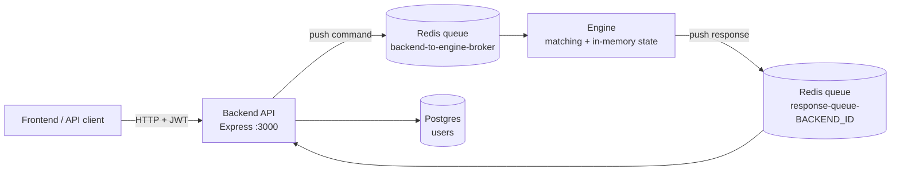

# Mini Centralized Spot Exchange

A mini centralized exchange (CEX) built with **TypeScript, Bun, Express, Redis, and Postgres**. The HTTP backend and the matching engine are two separate processes that communicate only through Redis queues.

- The **backend** authenticates users, validates requests, and forwards commands to the engine.
- The **engine** owns all exchange state (balances, order books, orders, fills) in memory and performs order matching.

## Architecture




### Request flow

1. The client sends an HTTP request with a JWT (`Authorization: Bearer <token>`).
2. The backend validates it, then pushes a message onto `backend-to-engine-broker` containing a `correlationId`, its own `responseQueue`, a `type`, and a `payload`.
3. The backend stores the pending HTTP request keyed by `correlationId` and waits (with a timeout).
4. The engine pops the message, runs the operation against its in-memory state, and pushes the result onto `message.responseQueue` with the **same** `correlationId`.
5. The backend matches the `correlationId` to the pending request and returns the result to the client.

Each backend process has its own response queue (`response-queue-${BACKEND_QUEUE_ID}`), so multiple backend instances can share one engine without mixing up responses.

### Message format

```ts
// Backend -> Engine
interface EngineRequest {
  correlationId: string;
  responseQueue: string;
  type: "create_order" | "get_depth" | "get_user_balance" | "get_order" | "cancel_order";
  payload: Record<string, unknown>;
}

// Engine -> Backend
interface EngineResponse {
  correlationId: string;
  ok: boolean;
  data?: unknown;
  error?: string;
}
```

## Tech stack

| Area | Technology |
| --- | --- |
| Language | TypeScript |
| Runtime | Bun |
| HTTP server | Express |
| Messaging | Redis queues (backend ↔ engine) |
| Database | Postgres via Prisma (users) |
| Auth | JWT, with hashed passwords |
| Validation | Zod |

## Features

- Signup and signin backed by Postgres, with JWT-protected exchange routes
- Backend ↔ engine communication over Redis queues using correlation IDs
- In-memory matching engine with **price-time priority**
- Limit orders (and market orders), with partial fills
- Order statuses: `open`, `partially_filled`, `filled`, `cancelled`
- Fills returned with every matched trade
- Depth grouped by price level (bids high → low, asks low → high)
- Order cancellation that removes the remaining quantity from the book

## API

### Public (database only)

| Method | Route | Description |
| --- | --- | --- |
| POST | `/signup` | Create a user and return a JWT |
| POST | `/signin` | Verify credentials and return a JWT (`401` on invalid credentials) |

Body for both:

```json
{ "username": "alice", "password": "password123" }
```

### Protected (handled by the engine)

All routes require `Authorization: Bearer <jwt-token>`.

| Method | Route | Engine command | Description |
| --- | --- | --- | --- |
| POST | `/order` | `create_order` | Place a limit or market order |
| GET | `/depth/:symbol` | `get_depth` | Order book depth for a symbol |
| GET | `/balance` | `get_user_balance` | The user's balances |
| GET | `/order/:orderId` | `get_order` | Order details and status |
| DELETE | `/order/:orderId` | `cancel_order` | Cancel an open or partially filled order |

Example order:

```json
{
  "type": "limit",
  "side": "buy",
  "symbol": "BTC",
  "price": 100,
  "qty": 10
}
```

Example depth response:

```json
{
  "symbol": "BTC",
  "bids": [{ "price": 100, "qty": 10 }, { "price": 99, "qty": 5 }],
  "asks": [{ "price": 110, "qty": 4 }, { "price": 111, "qty": 6 }]
}
```

## Matching rules

- A **buy** limit order matches an ask when `buyPrice >= askPrice`, starting with the lowest ask.
- A **sell** limit order matches a bid when `sellPrice <= bidPrice`, starting with the highest bid.
- Within the same price level, the **oldest order is filled first** (time priority).
- Any unfilled remainder of a limit order rests on the book. A partially filled order has status `partially_filled`.
- Market orders match against the best available opposite-side prices until filled or the book is empty.
- Cancelling a filled order, or an order that does not exist, returns an error.

## Project structure

```txt
backend/
  src/
    index.ts                    # Express server + response queue listener
    routes/                     # HTTP routes
    controllers/                # auth and exchange controllers
    store/pending-responses.ts  # correlationId -> pending HTTP request
    utils/engine-client.ts      # sends commands to Redis, awaits replies
    utils/auth.ts               # JWT helpers
    db.ts                       # Prisma client
engine/
  src/
    index.ts                    # Redis consumer loop
    store/exchange-store.ts     # BALANCES, ORDERBOOKS, ORDERS, FILLS
    utils/env.ts
```

## Running locally

**Prerequisites:** [Bun](https://bun.sh), Redis, and Postgres running locally.

```bash
# 1. Environment files
cp backend/.env.example backend/.env
cp engine/.env.example engine/.env

# 2. Install dependencies
cd backend && bun install
cd ../engine && bun install

# 3. Run the backend (http://localhost:3000)
cd backend
bun run dev

# 4. Run the engine in another terminal
cd engine
bun run dev
```

Quick test:

```bash
# Sign up / sign in
curl -X POST localhost:3000/signup -H "Content-Type: application/json" \
  -d '{"username":"alice","password":"password123"}'

curl -X POST localhost:3000/signin -H "Content-Type: application/json" \
  -d '{"username":"alice","password":"password123"}'

# Place an order (use the token returned above)
curl -X POST localhost:3000/order \
  -H "Authorization: Bearer <token>" -H "Content-Type: application/json" \
  -d '{"type":"limit","side":"buy","symbol":"BTC","price":100,"qty":10}'

# Check depth
curl localhost:3000/depth/BTC -H "Authorization: Bearer <token>"
```

## Current limitations

- Engine state (balances, order books, orders, fills) lives in memory, so it is lost when the engine restarts.
- Only users are stored in Postgres. Orders and fills are not persisted yet.
- Clients must poll the REST endpoints to see order book changes.

## Future work

- [ ] **WebSockets:** stream live order book and trade updates to clients, so the order book updates continuously without polling.
- [ ] **Orders table:** persist every order in Postgres.
- [ ] **Fills table:** persist every trade in Postgres.
- [ ] **Engine recovery:** rebuild in-memory state from the database on startup.
- [ ] **Funds locking:** reserve balances for open limit orders.
